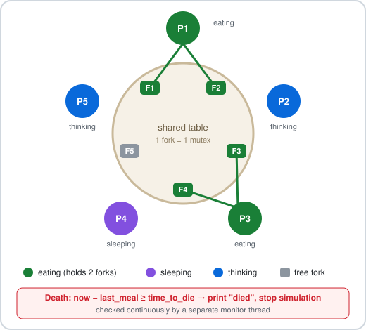
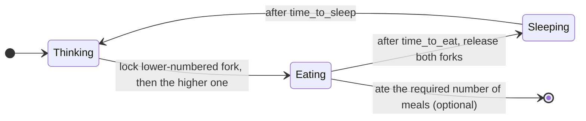

# philosophers

[](https://github.com/man-Yocto/philosophers/actions/workflows/ci.yml)

*This project has been created as part of the 42 curriculum by aalkhaso.*

## Description

The Philosophers project is a training exercise in multithreading and synchronization. It implements the classic Dining Philosophers problem using POSIX threads and mutexes. The objective is to simulate philosophers who must eat, sleep, and think while sharing a limited number of forks, without causing deadlocks or starvation and while respecting strict timing constraints.

Each philosopher is represented by a thread. Forks are protected with mutexes, and a monitoring routine supervises the simulation to detect when a philosopher dies or when all required meals have been eaten.

## The problem

<p align="center">
  
</p>

*N* philosophers sit around a table with *N* forks — one between each pair. To eat, a philosopher
needs **both** neighbouring forks, so two neighbours can never eat at the same time. Each
philosopher loops through three states:



A separate **monitor thread** watches everyone: if `now − last_meal ≥ time_to_die` for any
philosopher, it prints `died` and stops the simulation.

## How this implementation works

- **One thread per philosopher, one mutex per fork**, plus a monitor thread (`room_service`).
- **Deadlock prevention through resource ordering:** every philosopher locks the lower-numbered
  fork first, so a circular wait — everyone holding their left fork and waiting for the right —
  is impossible.
- **Starvation mitigation:** each philosopher's think time is computed from how much time is left
  before `time_to_die`, so hungry philosophers get to the forks first.
- **Precise timing:** eating and sleeping wait in short `usleep` slices while re-checking the stop
  flag, so the simulation ends promptly once someone dies.
- **Shared state** (`last_meal`, meal counters, stop flag, output) is protected by mutexes so
  log lines never interleave and no data race occurs.

## Key technical challenges

- Avoiding **deadlock** without a central waiter.
- Reporting a death within **10 ms** of it happening, even with many threads.
- Keeping `usleep` drift small enough that tight timings like `./philo 4 410 200 200` survive.
- Eliminating **data races** on values read by the monitor and written by philosopher threads.
- The single-philosopher edge case: one fork, so they can never eat and must die on time.

## Instructions

### Compilation

Move to the mandatory part directory and compile:
```
cd philo
make
```
This generates the executable:

```
philo
```

### Execution

Run the program with the following arguments:

```
./philo number_of_philosophers time_to_die time_to_eat time_to_sleep [number_of_times_each_philosopher_must_eat]
```

Examples:

```
./philo 5 800 200 200

./philo 5 800 200 200 7
```

### Program Rules

* One thread per philosopher
* One mutex per fork
* A philosopher must take two forks before eating
* The simulation stops when a philosopher dies or when all philosophers have eaten the required number of meals (if provided)
* Status messages are printed with timestamps in milliseconds

### Cleaning

Remove compiled files:

```
make fclean
```

## What I learned

<!-- TODO: write this section yourself -->

## Resources

* Dining Philosophers Problem
  [https://en.wikipedia.org/wiki/Dining_philosophers_problem](https://en.wikipedia.org/wiki/Dining_philosophers_problem)

* POSIX Threads Overview
  [https://man7.org/linux/man-pages/man7/pthreads.7.html](https://man7.org/linux/man-pages/man7/pthreads.7.html)

* Mutex Documentation
  [https://man7.org/linux/man-pages/man3/pthread_mutex_lock.3p.html](https://man7.org/linux/man-pages/man3/pthread_mutex_lock.3p.html)

* Deadlock Prevention Strategies
  [https://www.geeksforgeeks.org/dining-philosopher-problem-using-semaphores/](https://www.geeksforgeeks.org/dining-philosopher-problem-using-semaphores/)

### Use of AI

AI was used as a learning and assistance tool for:

* Understanding threads, mutexes, and race conditions
* Exploring strategies to avoid deadlock and starvation (min/max ordering, even/odd staggering, trylock approaches)
* Debugging synchronization and timing issues
* Structuring and writing this README

All code logic and final implementation were written manually after studying the provided explanations.

### Contact

[aalkhaso@student.42amman.com](mailto:aalkhaso@student.42amman.com)

